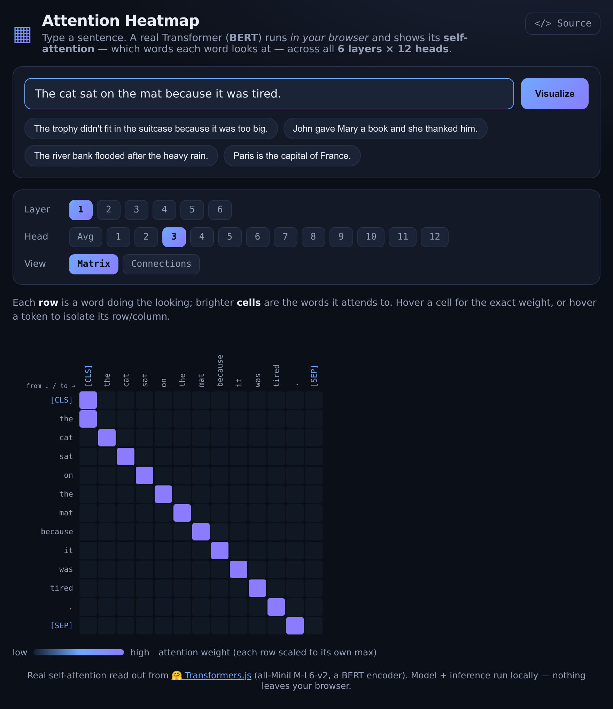

# Attention Heatmap (in-browser Transformer self-attention)

See **what a Transformer actually looks at**. Type any sentence and a real BERT encoder runs **entirely in your browser**, exposing its **self-attention** across all **6 layers × 12 heads** as an interactive heatmap and a BertViz-style connection view.

> **Live demo:** https://tongchen2010.github.io/assets/demos/attention-heatmap.html



---

## What it shows

Self-attention is the core mechanism of the Transformer: for every token, the model computes how much it should "attend to" every other token. This demo reads those weights straight out of a running model.

- **Matrix view** — an N×N heatmap. Each **row** is a token doing the looking; brighter **cells** are the tokens it attends to. Hover any cell for the exact weight; hover a token to isolate its row/column.
- **Connections view** — tokens on both sides with arcs whose thickness/opacity encode attention strength (hover a word to isolate its links).
- **Layer / Head selectors** — step through all 6 layers and 12 heads (or average the heads). Different heads specialize: some track the previous/next word, some align to punctuation or `[SEP]`, some capture coreference.

Try the Winograd-style example *"The trophy didn't fit in the suitcase because it was too big."* and watch where **it** attends in the deeper layers.

## How it works

1. [🤗 Transformers.js](https://github.com/huggingface/transformers.js) loads **all-MiniLM-L6-v2** (a BERT encoder) from the Hugging Face CDN — a build [ONNX-exported *with attention outputs*](https://huggingface.co/bradynapier/all_miniLM_L6_v2_with_attentions_onnx) so the attention tensors are returned to JS.
2. Your sentence is tokenized (WordPiece, with `[CLS]`/`[SEP]`) and run through the model in the browser.
3. The model returns `attention_1 … attention_6`, each shaped `[1, 12, seq, seq]` — softmax probabilities (every query row sums to 1). The UI renders the selected layer/head and scales each map to its own max.

Everything — model and inference — runs locally (WebAssembly). No server, no API key, no data leaves your device.

## Run locally

```bash
python3 -m http.server 8000
# open http://localhost:8000/
```

## Note

The first load downloads the model (~91 MB); afterward it's instant from cache. Best on a modern desktop browser.

## License

MIT © Tong Chen
